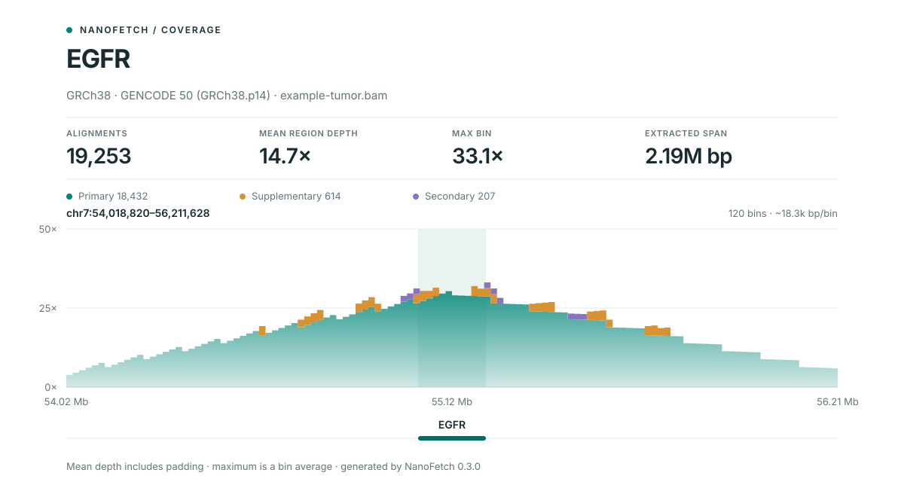

# NanoFetch

Extract gene regions from BAM and CRAM files, offline.

[](https://github.com/AlexanderM-M/Nanofetch/actions/workflows/tests.yml)
[](https://pypi.org/project/nanofetch/)
[](https://github.com/AlexanderM-M/Nanofetch/blob/main/LICENSE)

NanoFetch turns gene symbols into genomic intervals and extracts overlapping
alignments, with configurable padding. It bundles versioned annotations for
**GRCh37, GRCh38, and T2T-CHM13v2.0** and detects the assembly from chromosome
lengths. No annotation downloads are needed at runtime.

## Install

Requires Python 3.9 or newer.

```bash
python -m pip install nanofetch
```

For an isolated command-line installation, use `pipx install nanofetch`.
`pysam` is the only runtime dependency; a separate `samtools` installation is
not required. For development, see [Contributing](https://github.com/AlexanderM-M/Nanofetch/blob/main/CONTRIBUTING.md).

## Quick start

Use your own **coordinate-sorted, indexed** BAM or CRAM file:

```bash
nanofetch tumor.bam EGFR --index
```

This writes `EGFR.bam` and `EGFR.bam.bai` in the current directory and reports
the detected assembly, annotation version, and number of extracted alignments.
Preview the region and check output conflicts with `nanofetch tumor.bam EGFR --dry-run`.

| Default | Behavior |
|---|---|
| Region | Gene interval plus **1 Mb on each side**; use `--padding 0` for the gene alone |
| Records | Overlapping alignments; secondary and supplementary records excluded |
| Output | One BAM per gene in the current directory |
| Indexing | Opt in with `--index` |
| Existing files | Protected unless `--force` is supplied |

## Common workflows

**One gene**, with output in a sample directory:

```bash
nanofetch tumor.bam EGFR --output-dir results/tumor --index
```

**A panel**, with one BAM per gene:

```bash
nanofetch tumor.bam --panel cns --output-dir results/tumor-cns --index
```

**One combined BAM**, with overlapping regions deduplicated:

```bash
nanofetch tumor.bam EGFR CDK4 PDGFRA --combined results/tumor-panel.bam --index
```

`--output-dir` applies only to per-gene BAMs and their indexes. For a combined
BAM or reports, provide the full desired path, such as
`--manifest results/tumor/regions.tsv`. Relative paths start in your current
working directory. See [output locations](https://github.com/AlexanderM-M/Nanofetch/blob/main/docs/usage.md#where-outputs-go).

## Coverage overview

Extract a gene and create a self-contained SVG plot:

```bash
nanofetch tumor.bam EGFR --output-dir results/egfr-qc --index \
  --plot results/egfr-qc/coverage.svg
```



The plot marks the gene body and shows the bin size. Mean depth includes the
padded region; maximum depth is a bin average.

## Documentation and support

- [Usage guide](https://github.com/AlexanderM-M/Nanofetch/blob/main/docs/usage.md): custom panels, CRAM references, BED export,
  coverage summaries, manifests, and alignment selection.
- [Troubleshooting](https://github.com/AlexanderM-M/Nanofetch/blob/main/docs/troubleshooting.md): installation, indexes, assembly
  detection, gene names, and empty outputs.
- [Annotation provenance](https://github.com/AlexanderM-M/Nanofetch/blob/main/docs/annotations.md): pinned sources and checksums.
- [Changelog](https://github.com/AlexanderM-M/Nanofetch/blob/main/CHANGELOG.md) and [contribution guide](https://github.com/AlexanderM-M/Nanofetch/blob/main/CONTRIBUTING.md).
- [Report a bug or request a feature](https://github.com/AlexanderM-M/Nanofetch/issues/new/choose).

Run `nanofetch --help` for all options or `nanofetch --list-panels` for installed
panel names and descriptions. The built-in CNS panel is a convenience set, not
a validated clinical assay.

NanoFetch extracts overlapping alignments. It does not retrieve distant mates
or every segment of a read, accept custom GTF annotations, or write CRAM output.

## License

[MIT](https://github.com/AlexanderM-M/Nanofetch/blob/main/LICENSE). T2T consortium data are released under CC0; see the upstream
[CHM13 data reuse policy](https://github.com/marbl/CHM13#data-reuse-and-license).
