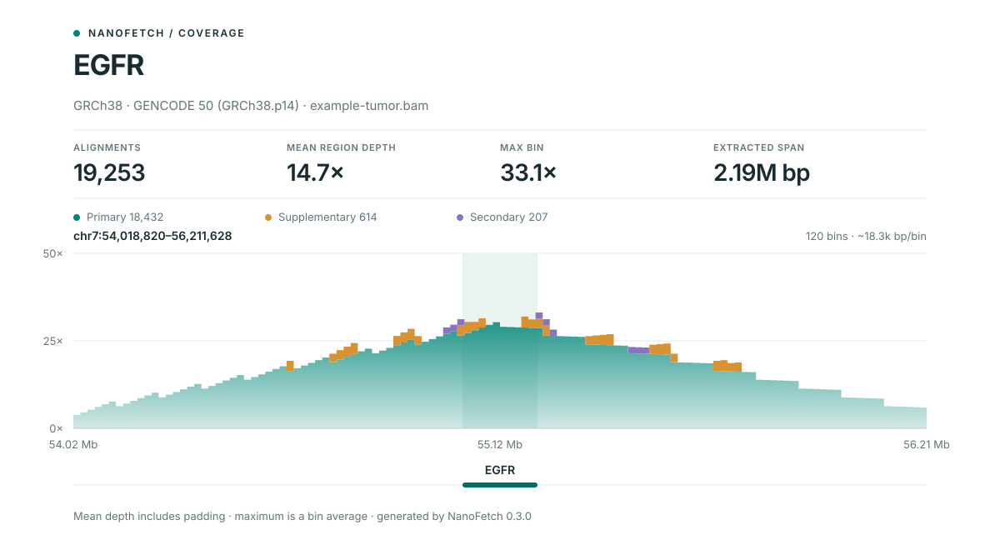

# Usage guide

[Back to the README](../README.md) · [Troubleshooting](troubleshooting.md)

The examples use your own coordinate-sorted, indexed alignment file.

## Selecting genes and assemblies

One gene, using the default 1 Mb padding on both sides:

```bash
nanofetch tumor.bam EGFR
```

Several genes:

```bash
nanofetch tumor.bam --genes EGFR CDK4 PDGFRA CDKN2A MET
```

Write one deduplicated, indexed BAM for all selected genes:

```bash
nanofetch tumor.bam --panel cns --combined cns.bam --index
```

Read a custom panel containing whitespace- or comma-separated symbols and `#`
comments:

```bash
nanofetch tumor.bam --gene-file my-panel.txt --combined panel.bam --index
```

Compact families are accepted:

```bash
nanofetch tumor.bam CDKN2A/B NTRK1/2/3
```

Use the built-in CNS convenience panel:

```bash
nanofetch tumor.bam --panel cns --index --output-dir cns-regions
```

Use T2T-CHM13 explicitly, or let `nanofetch` detect it from chromosome lengths:

```bash
nanofetch t2t-aligned.bam EGFR --genome t2t
nanofetch t2t-aligned.bam --panel cns --genome hs1
```

Indexed CRAM input is supported. Supply its reference explicitly when required:

```bash
nanofetch tumor.cram EGFR --reference GRCh38.fa --index
```

## Previewing regions and writing reports

Inspect the resolved regions without writing BAMs:

```console
nanofetch tumor.bam EGFR --dry-run
Genome: GRCh38
Annotation: GENCODE 50 (GRCh38.p14)
EGFR   chr7:54018820-56211628   EGFR.bam
```

Generate a reproducibility manifest:

```bash
nanofetch tumor.bam EGFR MET --index --manifest regions.tsv
```

Export resolved padded regions as BED without extracting BAMs:

```bash
nanofetch tumor.bam --gene-file my-panel.txt --write-bed regions.bed --dry-run
```

Write compact gene-body coverage QC for every selected gene:

```bash
nanofetch tumor.bam --panel cns --combined cns.bam --summary coverage.tsv
```

The summary reports alignment count, mean depth, mean mapping quality, and the
percentage of gene bases covered at 1×, 10×, and 30×.

## SVG coverage plot

Create a self-contained coverage overview for one extracted gene:

```bash
nanofetch tumor.bam EGFR --plot EGFR.coverage.svg
```

The plot shows mean aligned-base depth in fixed-width bins, the annotated gene
body, requested extraction span, assembly and annotation provenance, and counts
for primary, supplementary, and secondary alignments. It visualizes the output
BAM, so `--include-supplementary` and `--include-secondary` are reflected in the
plot. SVG generation has no dependency beyond NanoFetch itself.



Run `nanofetch --help` for all options.

## Where outputs go

All relative paths are resolved from the directory where you run the command.
Parent directories are created as needed for output files.

| Option | Destination |
|---|---|
| No output options | One `GENE.bam` in the current directory |
| `--output-dir DIR` | Per-gene BAMs and their indexes inside `DIR` |
| `--combined FILE.bam` | One union BAM at exactly the supplied path |
| `--index` | A `.bai` beside each output BAM |
| `--manifest`, `--summary`, `--write-bed`, `--plot` | Exactly the supplied file path |

`--output-dir` does not relocate a combined BAM or any report. To keep a sample's
outputs together, specify each path explicitly:

```bash
nanofetch tumor.bam EGFR MET --output-dir results/tumor --index \
  --manifest results/tumor/regions.tsv --summary results/tumor/coverage.tsv
```

For combined output:

```bash
nanofetch tumor.bam --panel cns --combined results/tumor/cns.bam --index \
  --write-bed results/tumor/regions.bed
```

Use a separate directory for each sample to avoid repeated gene filenames.
Existing outputs are protected; use `--force` only when replacement is intended.

`--dry-run` prints resolved regions and planned BAM paths without extracting BAMs.
It can be combined with `--write-bed`, which **does write a BED file**. It cannot
be combined with `--manifest`, `--summary`, or `--plot`. It checks planned BAM
and index paths for conflicts; `--force` allows previewing existing outputs
without replacing them.
Displayed regions and TSV region strings use 1-based inclusive coordinates;
BED files use 0-based, half-open coordinates.

## What is selected?

An alignment is selected when its aligned reference span overlaps the padded gene
interval. It does not need to span the entire region.

By default, secondary (`0x100`) and supplementary (`0x800`) records are excluded.
Use `--include-secondary` and `--include-supplementary` to retain records of those
types that overlap the region.

`--include-supplementary` does **not** retrieve distant segments merely because a
different segment from the same read overlaps the requested gene. That operation
requires a read-name-based second pass and is intentionally outside the default
semantics.

Overlapping padded intervals for multiple copies of the same symbol are merged, so
an alignment is not written twice. Separate gene output BAMs may contain the same
alignment when their padded regions overlap; this is expected.

## Genome detection and contig names

Automatic detection compares exact primary-chromosome lengths in the BAM header.
It will stop rather than guess when the build is ambiguous. The explicit spellings
below are accepted:

| Assembly | Accepted names | Bundled annotation |
|---|---|---|
| GRCh37 | `grch37`, `hg19` | GENCODE 50lift37 |
| GRCh38 | `grch38`, `hg38` | GENCODE 50 |
| T2T-CHM13v2.0 | `t2t`, `hs1`, `chm13`, `chm13v2.0` | RefSeq/Liftoff v5.3 |

Both `chr7` and `7` naming styles are supported. T2T GenBank names such as
`CP068271.2` and RefSeq names such as `NC_060931.1` are also mapped to their
chromosomes.

## Input and output safety

The input must be coordinate-sorted and indexed: BAM uses BAI or CSI, while CRAM
uses CRAI. CRAM decoding can use `--reference FASTA`. `nanofetch` does not modify
the input or create an input index automatically.

Existing output BAMs are protected unless `--force` is supplied. Outputs are
written to a temporary file and moved into place only after writing succeeds.
When an output is replaced, any stale BAI or CSI is removed. `--index` creates a
fresh BAI. Plot and manifest files receive the same collision protection, and
manifests are also written atomically.

Before extraction starts, `nanofetch` checks all planned BAM, index, plot, and
manifest paths for conflicts. It refuses to use the input BAM or either of its
conventional index paths as an output, even when `--force` is supplied.

## Built-in CNS panel

The `cns` panel currently contains:

```text
EGFR PDGFRA CDK4 MDM2 MDM4 MET CDKN2A CDKN2B NF1 PTEN TERT
BRAF FGFR3 NTRK1 NTRK2 NTRK3 ALK
```

This is a transparent convenience set, not a validated clinical assay. Use
`nanofetch --list-panels` to list installed panel names and descriptions.

